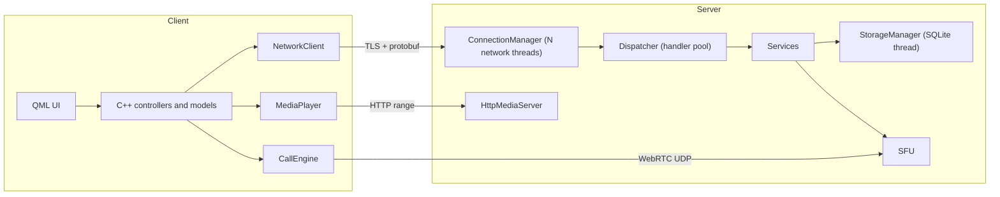

# QtMeet - Offline Communication Suite

A Qt 6 / QML client-server application for closed, offline networks (multiple routed subnets, no internet, no cloud services). Windows and Linux.

## Features

- **Users**: register / login, user search, presence (online, busy, in call)
- **Chat**: direct and meeting chat, history, file sharing (chunked, resumable uploads)
- **Calls**: 1:1 voice and video calls
- **Meetings**: create a meeting, others join with a short code (5-20 participants)
- **Streaming server**: the server hosts a selected folder; clients browse it and play files (video + audio, seekable)
- **Media**: FFmpeg-based encode / decode / scale / resample; sources from file, local camera / microphone or RTSP IP camera; automatic GPU (NVENC, QSV, AMF, VAAPI, D3D11VA) or CPU selection based on available hardware and load

## Stack

| Layer | Choice |
|---|---|
| UI | QML (Qt Quick) with a C++ core |
| Framework | Qt 6.8 LTS: quick, qml, multimedia, network, sql, concurrent |
| Build | qmake (`.pro` / `.pri`) |
| Control protocol | Google protobuf over TLS (`QSslSocket`), length-prefixed frames |
| Real-time media | libdatachannel (WebRTC), server-side SFU, no STUN/TURN needed |
| Codecs / media | FFmpeg (LGPL build), Opus, H.264 |
| Audio processing | webrtc-audio-processing (echo cancellation, noise suppression, gain) |
| File streaming | Own HTTP server (`QTcpServer`) with HTTP Range requests |
| Storage | SQLite, owned by a single storage thread |

## Architecture



All media goes through the server, so clients never connect to each other directly. Between subnets only these server ports need to be reachable:

| Port | Purpose |
|---|---|
| TCP 7400 | control channel (login, chat, signaling, file upload) |
| TCP 7401 | HTTP media (hosted folder, attachments) |
| UDP 40000-40100 | WebRTC media |

## Project layout

```
QtMeet.pro              root project (subdirs)
config/                 shared .pri files and third-party library settings
proto/                  messages.proto -> qmproto (static lib)
common/                 qmcommon: framing, config, logging, ids, resource monitor
media/                  qmmedia: FFmpeg helpers (source, decoder, encoder, scaler,
                        resampler, muxer, HW detection, clock, player, capture)
rtc/                    qmrtc: WebRTC peer, RTP (de)packetizers, jitter buffer, AEC
server/                 QtMeetServer
  net/                  ConnectionManager, NetWorker, Connection, SessionRegistry
  dispatch/             Dispatcher, IHandler, RequestContext
  services/             Auth, User, Chat, File, Meeting, Folder services
  storage/              StorageManager (single SQLite owner)
  streaming/            Sfu, HttpMediaServer
  admin/, qml/          admin window (hosted folder, online users)
client/                 QtMeetClient
  core/                 NetworkClient, FileTransfer, CallEngine
  controllers/          Session, Chat, Call, Explorer (QML singletons)
  models/               list models for QML
  qml/                  pages and components
Reference/              design plan (local only, git-ignored)
```

## Building

**Full install guide (FFmpeg, libdatachannel, env vars, 1-PC test):** see [`docs/DEVELOPMENT.md`](docs/DEVELOPMENT.md).

### Requirements

- Qt 6.8+ with Qt Multimedia, Qt Quick Controls, Qt Network
- C++17 compiler (MSVC 2022, MinGW 13, GCC 11+)
- protobuf (protoc + library)
- FFmpeg (LGPL build), libdatachannel, Opus, webrtc-audio-processing 1.x

### Library locations

Set install prefixes (each containing `include/` and `lib/`) as environment variables. On Linux, FFmpeg, Opus and webrtc-audio-processing fall back to pkg-config when unset.

| Variable | Library |
|---|---|
| `PROTOBUF_DIR` | protobuf (also `bin/protoc`) |
| `PROTOBUF_LIBS` | optional link override (protobuf >= 22 also needs abseil libs) |
| `FFMPEG_DIR` | FFmpeg |
| `DATACHANNEL_DIR` | libdatachannel |
| `OPUS_DIR` | Opus |
| `APM_DIR` | webrtc-audio-processing |

### Build

```
mkdir build && cd build
qmake ../QtMeet.pro
nmake            # MSVC
# mingw32-make   # MinGW
# make -j        # Linux
```

Output: `build/bin/QtMeetServer` and `build/bin/QtMeetClient`.

## Running

```
QtMeetServer [--config server.ini] [--headless]
QtMeetClient [--config client.ini]
```

The server opens an admin window to choose the hosted folder and start / stop the service; `--headless` runs it as a console service.

## Status

| Step | Content | State |
|---|---|---|
| 0 | Module structure, protocol, class prototypes, QML skeleton | done |
| Prep | Dev TLS certs (`server/certs`), FFmpeg + protobuf defaults | done |
| 1 | TLS framing, login/register, online presence, admin user list | done |
| 2 | SQLite storage, persistent users, full user search with live presence | done |
| 3 | Chat and file sharing | done |
| 4 | FFmpeg helpers and media player | done |
| 5 | Hosted folder streaming | done |
| 6 | 1:1 calls via SFU | done |
| 7 | Group meetings | done |

See [Reference/COMPLETION_PLAN.md](Reference/COMPLETION_PLAN.md) for the full completion roadmap.

### Phase 1 quick test

1. Run `QtMeetServer`, click **Start** (or `QtMeetServer --headless`).
2. Run two `QtMeetClient` windows.
3. On each, check **Create new account**, register different usernames, Sign in.
4. Server admin **Online users** should list both display names.

### Phase 2 quick test

Users are stored in SQLite at `<dataDir>/qtmeet.db` (default on Windows: `%APPDATA%/QtMeet/QtMeetServer/data/qtmeet.db`). Passwords are PBKDF2-SHA256 hashed. Delete the file to reset all accounts.

1. Register users A and B, then stop and restart the server.
2. Sign in as A. On the main page, open **People** (or type in **Search people...**): every registered user is listed; typing `b` filters to B, shown with a grey (offline) dot.
3. Sign in as B in a second client. B's dot in A's list turns green without refreshing.
4. Registering an existing username (any letter case) fails with a conflict error (code 5).
5. Clicking a user shows them in the conversation header with live presence.

### Phase 3 quick test

Chat and attachments use the control TLS channel; downloads use HTTP on port 7401 (`/files/<fileId>?t=<session_token>`).

1. Sign in as A and B. On A open **People**, select B, send a text message — B sees it live; **Chats** lists the conversation.
2. Restart the server, sign in as A again, open the chat — history reloads from SQLite.
3. Attach a small file (paperclip). A shows upload progress; B gets a file bubble and can download it (saves to the system Downloads folder).
4. Sending the same file again is deduplicated by sha256 (instant FileDone).

### Phase 4 quick test

Requires FFmpeg shared libs (`FFMPEG_DIR` or pkg-config).

1. Sign in → open **Files** → **Local…** and pick a local video or audio file.
2. PlayerPage: Play / Pause / Stop / seek / volume; video appears in `VideoOutput`, audio through the default output device.
3. Toolbar shows **GPU** when hardware decode was selected, otherwise **CPU**.

### Phase 5 quick test

1. On `QtMeetServer`, choose a **Hosted folder** containing media, then Start.
2. Client: Sign in → **Files** — listing loads from `DirListReq`.
3. Enter a folder, open a video/audio file — playback uses `http://<server>:7401/hosted?path=…&t=<session_token>` with HTTP Range seek.
4. Paths with `..` are rejected; empty hosted folder yields a clear error.

### Phase 6 quick test

Requires libdatachannel (`DATACHANNEL_DIR`) and UDP 40000–40100 reachable to the server.

1. Sign in as A and B on two clients.
2. A: **People** → select B → **Voice call** or **Video call**.
3. B: incoming CallView → **Accept** (or **Reject**).
4. Both sides: mute / camera / hang up; media flows client ↔ server SFU (not peer-to-peer).

### Phase 7 quick test

1. A: right panel **New meeting** → MeetingView shows a shareable code.
2. B: **Join with code** → enter the code → both see each other in the grid (up to 20 participants).
3. Mute / camera updates propagate; **Leave** removes a participant; the last leaver closes the meeting.

## Licensing notes

Use an LGPL build of FFmpeg (no `--enable-gpl`; prefer hardware encoders or OpenH264 over libx264) and link Qt dynamically under LGPL, or use commercial licenses.
