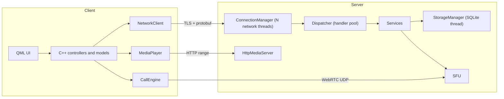

# QtMeet - Offline Communication Suite

A Qt 6 / QML client-server application for closed, offline networks (multiple routed subnets, no internet, no cloud services). Windows and Linux.

## Features

- **Users**: register / login, user search, presence (online, busy, in call)
- **Chat**: direct and meeting chat, history, file sharing (chunked, resumable uploads)
- **Calls**: 1:1 voice and video calls
- **Meetings**: create a meeting, others join with a short code (5-20 participants)
- **Streaming server**: the server hosts a selected folder; clients browse it and play files (video + audio, seekable)
- **Media**: FFmpeg-based encode / decode / scale / resample; sources from file, local camera / microphone or RTSP IP camera; automatic GPU (NVENC, QSV, AMF, VAAPI, D3D11VA) or CPU selection based on available hardware and load

## Stack

| Layer | Choice |
|---|---|
| UI | QML (Qt Quick) with a C++ core |
| Framework | Qt 6.8 LTS: quick, qml, multimedia, network, sql, httpserver, concurrent |
| Build | qmake (`.pro` / `.pri`) |
| Control protocol | Google protobuf over TLS (`QSslSocket`), length-prefixed frames |
| Real-time media | libdatachannel (WebRTC), server-side SFU, no STUN/TURN needed |
| Codecs / media | FFmpeg (LGPL build), Opus, H.264 |
| Audio processing | webrtc-audio-processing (echo cancellation, noise suppression, gain) |
| File streaming | `QHttpServer` with HTTP Range requests |
| Storage | SQLite, owned by a single storage thread |

## Architecture



All media goes through the server, so clients never connect to each other directly. Between subnets only these server ports need to be reachable:

| Port | Purpose |
|---|---|
| TCP 7400 | control channel (login, chat, signaling, file upload) |
| TCP 7401 | HTTP media (hosted folder, attachments) |
| UDP 40000-40100 | WebRTC media |

## Project layout

```
QtMeet.pro              root project (subdirs)
config/                 shared .pri files and third-party library settings
proto/                  messages.proto -> qmproto (static lib)
common/                 qmcommon: framing, config, logging, ids, resource monitor
media/                  qmmedia: FFmpeg helpers (source, decoder, encoder, scaler,
                        resampler, muxer, HW detection, clock, player, capture)
rtc/                    qmrtc: WebRTC peer, RTP (de)packetizers, jitter buffer, AEC
server/                 QtMeetServer
  net/                  ConnectionManager, NetWorker, Connection, SessionRegistry
  dispatch/             Dispatcher, IHandler, RequestContext
  services/             Auth, User, Chat, File, Meeting, Folder services
  storage/              StorageManager (single SQLite owner)
  streaming/            Sfu, HttpMediaServer
  admin/, qml/          admin window (hosted folder, online users)
client/                 QtMeetClient
  core/                 NetworkClient, FileTransfer, CallEngine
  controllers/          Session, Chat, Call, Explorer (QML singletons)
  models/               list models for QML
  qml/                  pages and components
Reference/              design plan (local only, git-ignored)
```

## Building

### Requirements

- Qt 6.8+ with Qt Multimedia, Qt HttpServer, Qt Quick Controls
- C++17 compiler (MSVC 2022, MinGW 13, GCC 11+)
- protobuf (protoc + library)
- FFmpeg (LGPL build), libdatachannel, Opus, webrtc-audio-processing 1.x

### Library locations

Set install prefixes (each containing `include/` and `lib/`) as environment variables. On Linux, FFmpeg, Opus and webrtc-audio-processing fall back to pkg-config when unset.

| Variable | Library |
|---|---|
| `PROTOBUF_DIR` | protobuf (also `bin/protoc`) |
| `PROTOBUF_LIBS` | optional link override (protobuf >= 22 also needs abseil libs) |
| `FFMPEG_DIR` | FFmpeg |
| `DATACHANNEL_DIR` | libdatachannel |
| `OPUS_DIR` | Opus |
| `APM_DIR` | webrtc-audio-processing |

### Build

```
mkdir build && cd build
qmake ../QtMeet.pro
nmake            # MSVC
# mingw32-make   # MinGW
# make -j        # Linux
```

Output: `build/bin/QtMeetServer` and `build/bin/QtMeetClient`.

## Running

```
QtMeetServer [--config server.ini] [--headless]
QtMeetClient [--config client.ini]
```

The server opens an admin window to choose the hosted folder and start / stop the service; `--headless` runs it as a console service.

## Status

| Step | Content | State |
|---|---|---|
| 0 | Module structure, protocol, class prototypes, QML skeleton | done |
| 1 | TLS framing, login, user list | pending |
| 2 | Network thread pool, dispatcher, storage, user search | pending |
| 3 | Chat and file sharing | pending |
| 4 | FFmpeg helpers and media player | pending |
| 5 | Hosted folder streaming | pending |
| 6 | 1:1 calls via SFU | pending |
| 7 | Group meetings | pending |

## Licensing notes

Use an LGPL build of FFmpeg (no `--enable-gpl`; prefer hardware encoders or OpenH264 over libx264) and link Qt dynamically under LGPL, or use commercial licenses.
